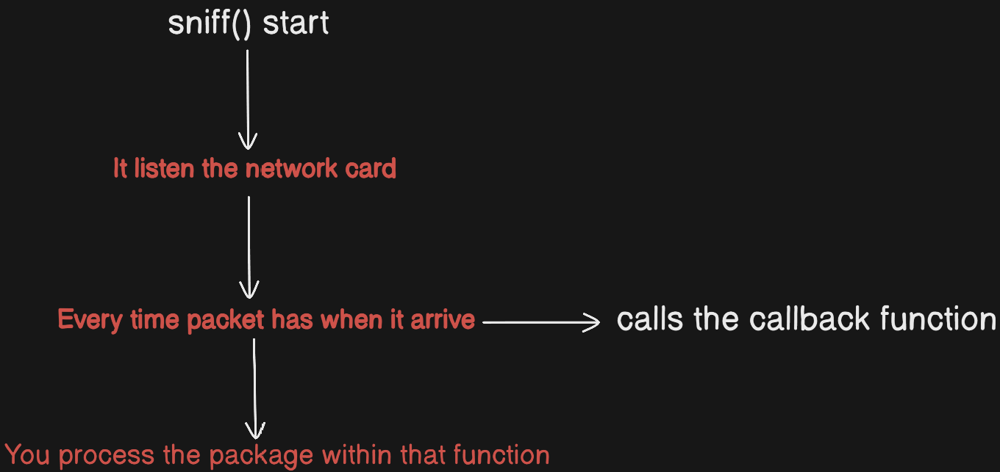

# Untitled

### First we understand this: What is the Packet?

Nothing on the internet happens in one go. When you open a web page:

`Server → [Piece 1] [Piece 2] [Piece 3] → You`

Every Piece mean it is Packet. Every packet Includes:

`Where it come? (source IP)`

`Where it go? (dest IP)`

`Which Protocol (TCP/UDP/…)`

`Which Port (80, 443)`

`Real Data (payload)`

### How to packets sniffing?

Normally Network Card works like this:

Incoming Packet → “This packet for my MAC address?” → Yes → Take it

                                                                                         → No → Drop

If Promiscous Mode opening:

Incoming Packet → “This packet for my MAC address” → Yes → Take it

                                                                                       → No → Take it anyway <- All Traffic

Scapy doing this automatic. We just say  “sniff it” 

### How works Sniffing on the Scapy?

On the Scapy lib have sniff() method. Logic is that:



### What we catching? - Plan

1. Listen Network
2. For Every Packtes: 

                → HTTP? → Show URL and data

                → DNS? → Show which domain was queried

                → TLS SNI → We cant see https request therefore we can look to TLS handshake.

1. Take a filter parameter from to user
2. Print to a screen

▶️▶️ If you want to my walkthrough about how can i make this tool you can visit my Medium Writeup with this link: [https://medium.com/@efeqozel/network-packet-listener-network-sniffer-tool-by-efe-ozel-87789f395542](https://medium.com/@efeqozel/network-packet-listener-network-sniffer-tool-by-efe-ozel-87789f395542)

## Usage

Type command with output option or not.

```jsx
sudo python3 [packetlistener.py](http://packetlistener.py) -i [İFACE] -o [FİLE NAME]
```


If you want to stop record or sniffing on network you can use CTRL + C.


You can find it .pcap file in the directory you are working.